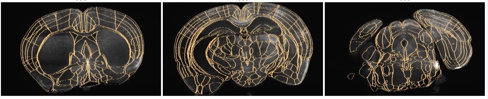
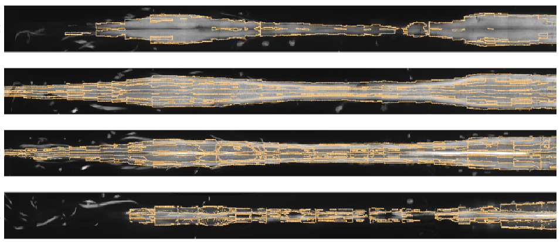
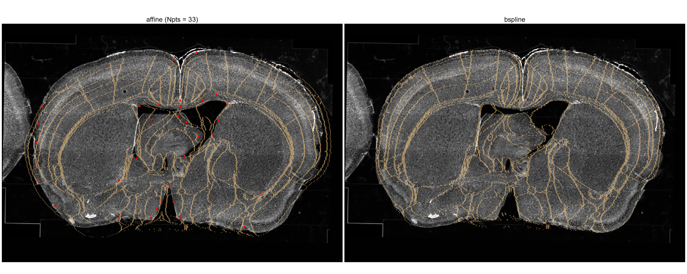

# LightSuite

**LightSuite** is an open-source MATLAB framework for scalable atlas registration and cell detection across the central nervous system. It processes 100 GB+ datasets on a standard workstation, turning raw image stacks into cell positions and regional intensities in atlas coordinates ([Allen CCFv3](https://alleninstitute.github.io/abc_atlas_access/descriptions/Allen-CCF-2020.html) for brain, [Fiederling et al., 2021](https://data.mendeley.com/datasets/4rrggzv5d5/1) for spinal cord).

Supported data: whole-brain and whole-spinal-cord volumes (light-sheet, fMOST, serial two-photon or any stitched 3D stack), wide-field coronal slices, and functional ultrasound (fUS) volumes.

A Python port is in development at [PyLightSuite](https://github.com/Wyss-Microscopy/PyLightSuite/tree/main); this repository is the reference implementation.

## Key features

- **Damage-resilient registration**: point clouds initialize the fit with Bayesian Coherent Point Drift, so tears, compression and missing structures become outliers rather than failures. Spinal cords are computationally untwisted.
- **User-steerable non-rigid fit**: a GUI re-fits the alignment live as you add landmark pairs, which enter the Elastix B-spline objective alongside mutual information.
- **Fast cell detection**: 3D band-pass filtering plus GPU-accelerated local background normalization give an illumination-invariant signal-to-background ratio; a lightweight CNN (98.7% validation accuracy) rejects artifacts. ~4.5 × 10⁵ cells per brain in 3–4 h.
- **No autofluorescence channel needed**: the reporter channel alone is enough to register, halving acquisition time and storage.
- **Atlas-space outputs**: cell positions, per-region counts, densities, soma diameters and intensities per hemisphere, plus atlas-aligned volumes for every channel.
- **Functional ultrasound**: align repeated sessions to a within-mouse seed, register to a vascular CCFv3 template, and map activation maps and timecourses into atlas space (optionally onto the Allen cortical flatmap).
- **Probe and implant tracing**: localize Neuropixels tracks (exported in [AP_histology](https://github.com/petersaj/AP_histology) `probe_ccf` format), optical fibers and GRIN lenses, including the regions beneath them.

## Installation

See the [installation guide](https://lightsuite.readthedocs.io/en/latest/installation/). In short:

1. MATLAB R2022b+ with Computer Vision, Image Processing, Optimization, Parallel Computing, and Statistics and Machine Learning toolboxes.
2. [Elastix 5.1.0](https://github.com/SuperElastix/elastix/releases/tag/5.1.0), added to your system `PATH`.
3. [matlab_elastix](https://github.com/dimokaramanlis/matlab_elastix) and [yamlmatlab](https://github.com/raacampbell/yamlmatlab) on your MATLAB path.
4. The Allen CCF (2020) and/or Fiederling et al. (2021) spinal cord atlas on your MATLAB path.

## Getting started

Example data: [doi:10.5281/zenodo.21338217](https://doi.org/10.5281/zenodo.21338217).

| Data | Entry point |
|---|---|
| Whole-brain volume | `demos/ls_analyze_lightsheet_volume.m` |
| Spinal cord volume | `demos/ls_analyze_spinal_cord.m` |
| Wide-field coronal slices (per-slice manual adjustment recommended) | `demos/ls_analyze_slice_volume.m` |
| Functional ultrasound ([docs](https://lightsuite.readthedocs.io/en/latest/usage_fusi/)) | `demos/ls_analyze_fusi.m` |
| Neuropixels tracing (after brain registration) | `demos/ls_trace_neuropixels.m` |
| GRIN lens / optical fiber tracing | `annotateGRINLens` |

  
  
  

Parameters, GUI instructions and tutorials are in the [documentation](https://lightsuite.readthedocs.io/en/latest/).

## Support

Check the [documentation](https://lightsuite.readthedocs.io/en/latest/) first. For bugs or requests, [open an issue](https://github.com/dimokaramanlis/LightSuite/issues) and include your OS, MATLAB version and the full error trace.

## License and citation

GPL-3.0; see `LICENSE`.

Karamanlis D, Xie Y, Foucher CG, Alappat M, Masood A, Dimitropoulou I, Pivron LAF, Martínez de Paz JM, Macé E, Gaspari S, El-Boustani S. *LightSuite: scalable atlas registration and cell detection across the central nervous system*. bioRxiv (2026). [doi:10.64898/2026.10.13.757638](https://www.biorxiv.org/content/10.64898/2026.10.13.757638)
